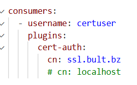
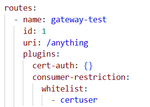

# cert-auth Plugin (Standalone)
## Description
Cert-auth is a Frank-Gateway plugin that allows for verification of a clients SAN/CN 

## Features:
- protect a route with a check for either a CN or a SAN 

## Requirements:
- Enabled in the config.yaml
- Requires TLS communication
- Requires a seperate consumer
- Requires a consumer restriction 

## Behavior 

The `cert-auth` plugin can map a client certificate to a consumer in multiple ways.

- `cn`: match the certificate Common Name (CN)
- `identifier`: match SAN or CN

it will check the incoming certificate to find a match with the allowed CN or SAN and give back a 403 if this fails. 

## Known issues

## Configuration 

### Plugin Metadata 
Name  cert-auth
Type  auth
Priority  2401

### Plugin Schema 
local consumer_schema = {
	type = "object",
	properties = {
		cn = {type = "string"},
		identifier = {type = "string"},
	},
	oneOf = {
		{ required = {"cn"} }, -- cn is kept around so existing consumer configs don't break, but identifier is the preferred field going forward.
		{ required = {"identifier"} },
	},
}

## Examples:

Routes enable `cert-auth: {}` and are combined with `consumer-restriction` to control which authenticated consumers may access each route.

Example behavior:

- `/anything` only allows `certuser`
- `/headers` only allows `testuser`
- `/test-cn-with-identifier` rewrites to `/anything` and allows `certuser`

This provides both certificate-based authentication and route-level authorization.

local _M = {
	version = 0.2,
	plugin, so APISIX knows it must pick a consumer
	schema = schema,
	consumer_schema = consumer_schema
}

For a full local setup and additional context, see `tests/cert-auth/README.MD`.